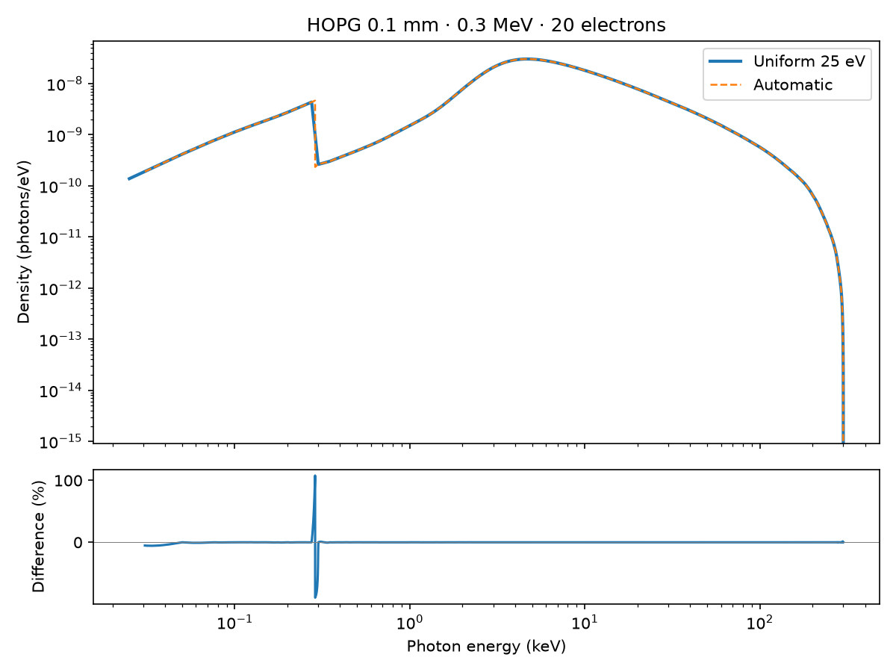
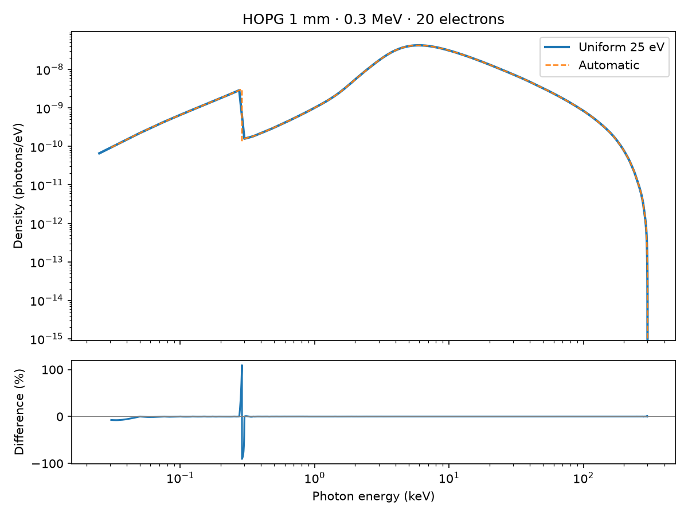
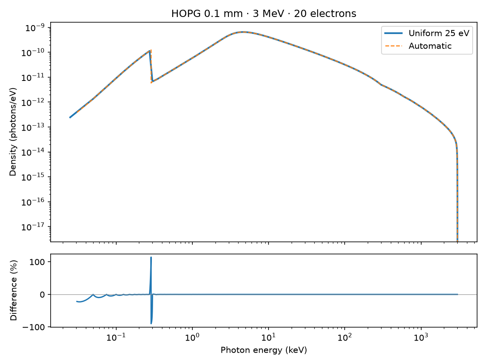
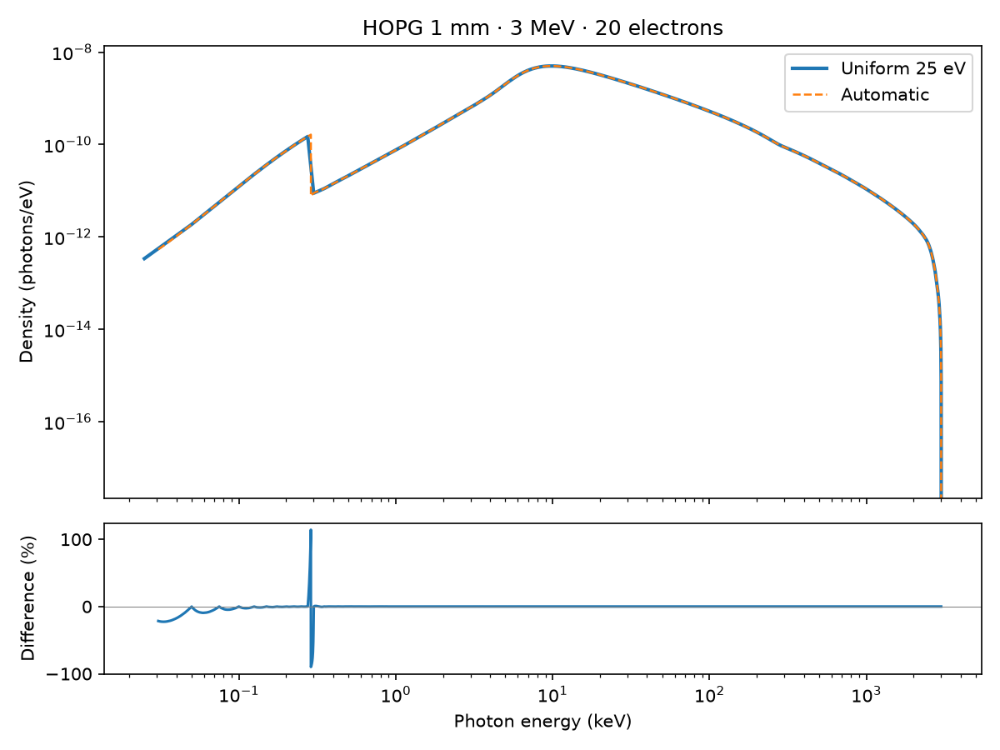
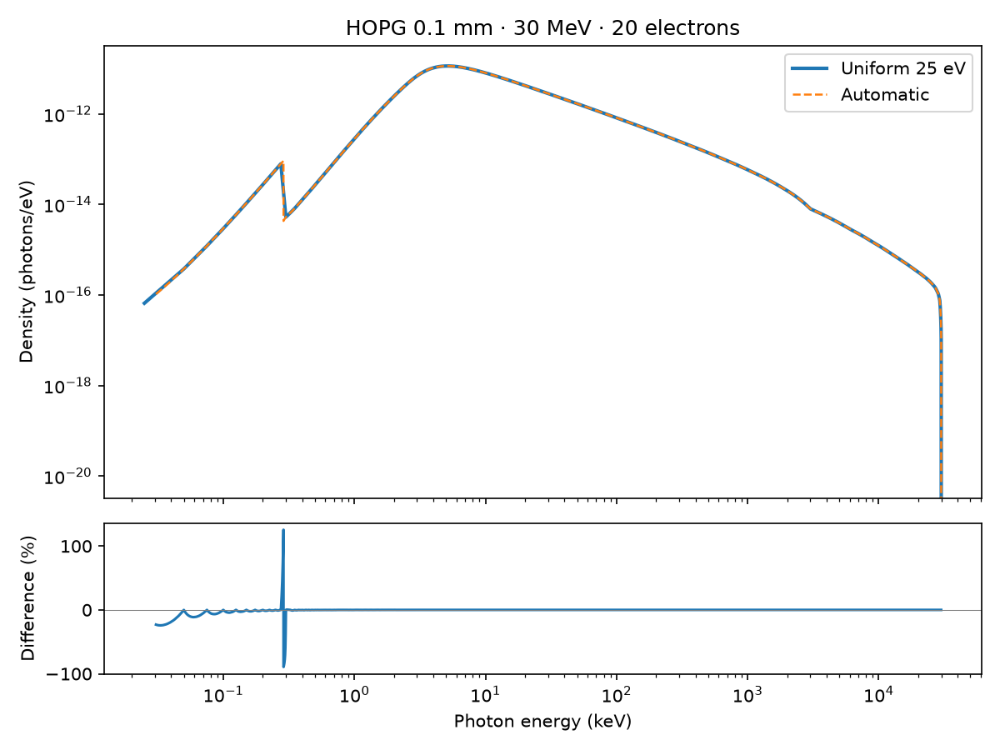
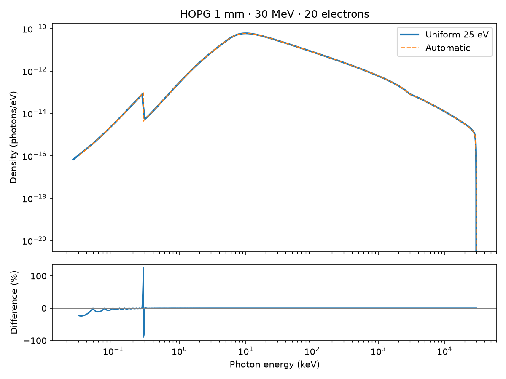
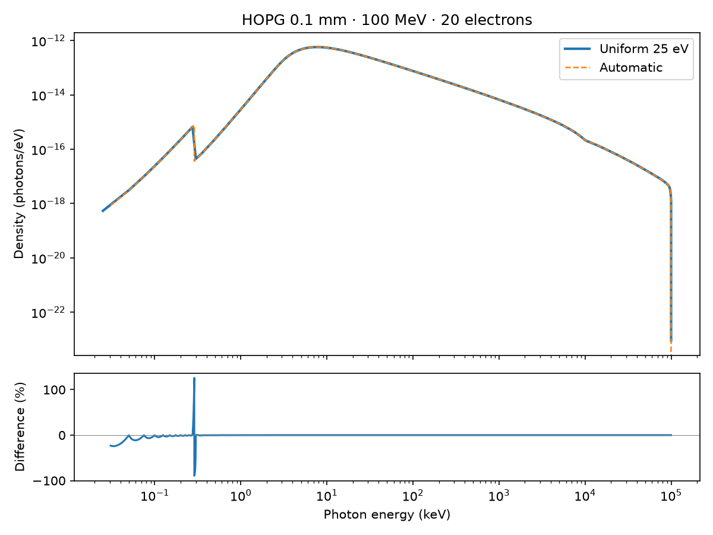
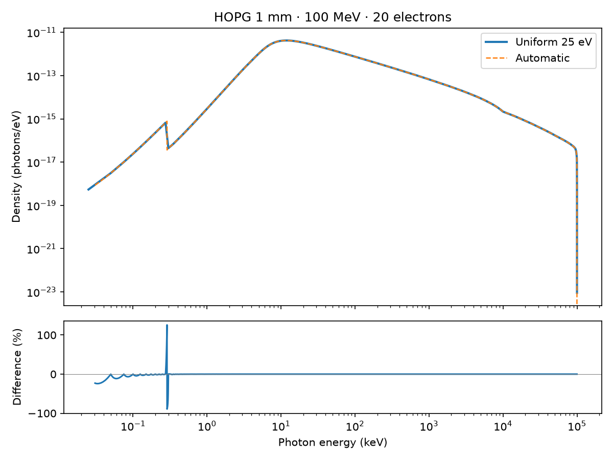

# Continuum grid benchmark comparison

**Preliminary grid-cost probes only.** The 20-electron runs below have no demonstrated ≤2% per-bin RSE. They do not satisfy the requested statistical spectral comparison. Measured Geant4 overlays and per-primary uncertainty estimates for both engines are still required; matching energy and thickness alone is insufficient.

[Machine-readable measurements](data/continuum-grid-2026-11-03.json). See the [beam-energy validity map](../../physics/capabilities.md#beam-energy-validity) for model scope.

Paired CUDA runner measurements for issue #278. Automatic case-local photon nodes are compared with an explicit uniform 25 eV continuum axis. These are numerical and performance comparisons, not independent validation of the radiation model.

## Protocol

HOPG, 45° polar / 180° azimuth, 20 electrons, seed 1; thicknesses 0.1 and 1 mm; incident energies 0.3, 3, 30 and 100 MeV. Each arm runs in a separate process after a one-electron transport/scoring warm-up. Two repeats reverse arm order. Both use the same explicit 600,000-node line axis from 0.1 to 100 keV. Timings include transport and spectrum reduction; case/grid construction and detector response are excluded. These bounded probes do not predict 20,000-electron runtime. The upper beam energy follows the documented transport benchmark range; line-model validity remains separate.

Job 3774, code 6584b1b11, one RTX 5080 GPU, 4 CPU threads, 24 GB requested host memory. Memory below is production-reported peak host RSS; GPU allocator peaks are retained in the linked JSON. Warm-up allocator history may contribute to peaks. Two repeats provide a range, not a confidence interval.

## Runtime and spectral agreement

| Beam (MeV) | Thickness (mm) | Uniform total range (s) | Automatic total range (s) | Mean speedup | Relative yield difference |
|---:|---:|---:|---:|---:|---:|
| 0.3 | 0.1 | 0.290–0.302 | 0.269–0.285 | 1.07× | 5.55e-06 |
| 0.3 | 1 | 0.437–0.457 | 0.424–0.424 | 1.05× | 3.62e-06 |
| 3 | 0.1 | 0.545–0.570 | 0.213–0.222 | 2.56× | 5.59e-06 |
| 3 | 1 | 1.371–1.465 | 1.006–1.012 | 1.41× | 1.45e-06 |
| 30 | 0.1 | 2.547–2.568 | 0.234–0.237 | 10.86× | 1.57e-06 |
| 30 | 1 | 4.732–4.860 | 0.970–0.971 | 4.94× | 1.09e-06 |
| 100 | 0.1 | 8.032–8.342 | 0.224–0.224 | 36.61× | 1.69e-06 |
| 100 | 1 | 13.672–13.774 | 0.971–0.979 | 14.07× | 1.21e-06 |

Spectral differences interpolate the uniform density onto automatic coordinates only within the shared band; bins below 1e-8 of the maximum reference density are omitted from the ratio. The automatic floor and 25 eV uniform floor differ, so integrated yield differences also include the low-energy band difference. Neither grid is an independent truth reference. The runner emits kinematic PXR/CBS warnings for the high-energy geometry: first-order line spectra may require dynamical diffraction. The plots here compare the bremsstrahlung continuum; the shared line workload is retained only in the runtime comparison.

The relative-difference plots expose large local differences near absorption edges and at the coarse uniform grid’s lowest energies, despite small integrated-yield differences. Agreement of integrated yield does not establish pointwise agreement.

## Spectra

### 0.3 MeV, 0.1 mm

### 0.3 MeV, 1 mm

### 3 MeV, 0.1 mm

### 3 MeV, 1 mm

### 30 MeV, 0.1 mm

### 30 MeV, 1 mm

### 100 MeV, 0.1 mm

### 100 MeV, 1 mm

## Memory and recovery

| Beam (MeV) | Thickness (mm) | Uniform host peak (MiB) | Automatic host peak (MiB) | Uniform GPU pool peak (MiB) | Automatic GPU pool peak (MiB) |
|---:|---:|---:|---:|---:|---:|
| 0.3 | 0.1 | 1233 | 1216 | 88 | 77 |
| 0.3 | 1 | 1237 | 1221 | 90 | 80 |
| 3 | 0.1 | 1915 | 1256 | 221 | 77 |
| 3 | 1 | 1951 | 1251 | 374 | 138 |
| 30 | 0.1 | 4622 | 1220 | 676 | 79 |
| 30 | 1 | 4648 | 1253 | 713 | 132 |
| 100 | 0.1 | 4441 | 1223 | 676 | 79 |
| 100 | 1 | 4476 | 1255 | 1283 | 134 |

Total recorded GPU OOM retries across the matrix: 0.

## Geant4 reference dispatch

Eight carbon reference cases are prepared at the same beam energies and target
thicknesses, with 100,000 histories, seed 1 and 32 Geant4 threads. Carbon number
density is copied from the HOPG case (0.11363677327755675 Å⁻³). The reference
uses the existing DPWA single-scattering benchmark with its matched transport
bounds and source-cone tallies; it does not implement crystal line radiation.
These reference tallies are not yet a matched comparison with the point-direction,
attenuated continuum plots above. Geometry, angular acceptance, photon transport
and normalization must be reconciled before adding a Geant4 overlay.

The requested 32-CPU submission was rejected: the CPU partition currently limits
allocations to 16 CPUs per node, despite the target node exposing 32 logical CPUs.
No Geant4 reference matrix job is running. The staged
`checks/continuum_geant4_queen.sbatch` requests 32 CPUs and must be submitted after
the scheduler limit is raised. No 16-thread result is substituted.

## Statistical comparison target

The requested follow-up uses **all-direction emission at creation**, normalized
per incident electron, with measured RSE ≤2% in every displayed energy bin in
both engines. It uses six logarithmic bins from 10 keV to the incident energy,
formed by merging adjacent groups of four pilot bins. It excludes photon escape
and detector response. This is a different observable from the directional,
attenuated weighted-grid spectra above. The matched statistical PyRITE arm
counts discrete coupled hard-bremsstrahlung photons; it must be labeled separately
from the weighted estimator and its grid-cost timings.

Geant4 spectral pilot 3780 used 100,000 histories per case. Across all directions,
its original 24-bin spectra had populated-bin RSE of 5–100%; its off-axis cone
had only 0–6 photons per case. Neither establishes the requested precision.
After merging to six bins, the projected histories needed for 2% range from
0.37 to 35.7 million per case. These are pilot projections, not achieved RSE.
Independent precision runs add a 50% planning margin and check observed
per-primary variance before marking convergence. Measured Geant4 overlays and
PyRITE uncertainties remain pending.
