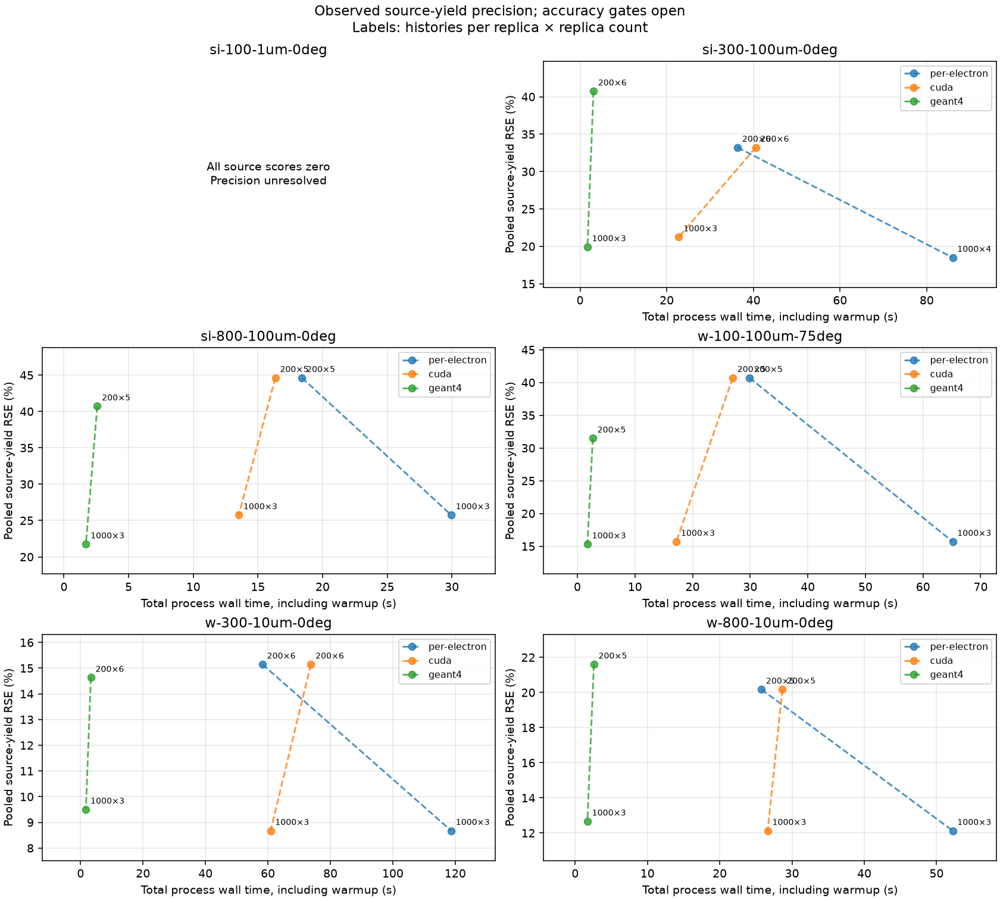
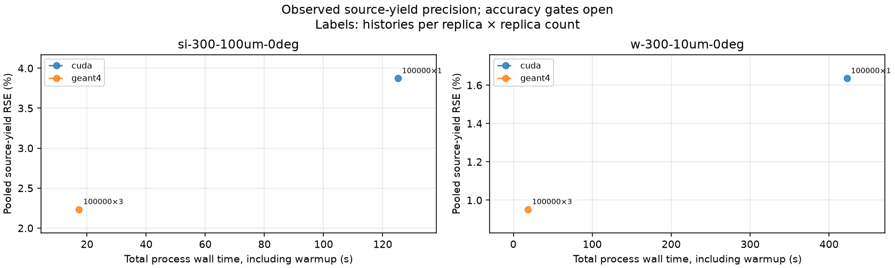
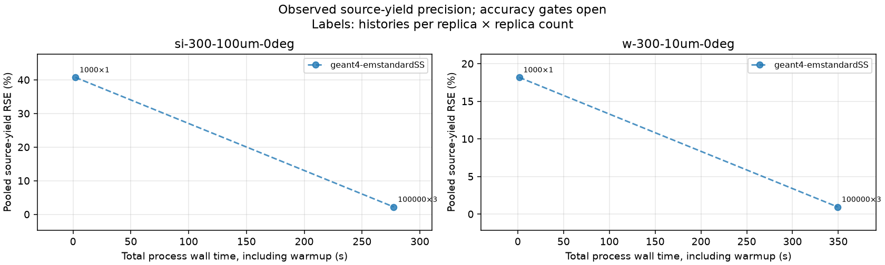

# Equal-precision comparator adapter pilot

This is the first implementation stage of [#510](https://github.com/Quantum-Light-Matter-Cooperative-QLMC/pyrite/issues/510),
measured on the lab box on 2026-10-14. It exercises coupled primary transport
and source-photon scoring. Numerical convergence and cross-code equivalence
have not been established, so it supports **no speedup or qualified time to
precision claim**. It adds no physics-validation claim or sign-off.

## Frozen pilot scope

The executable [manifest](../../../checks/equal_precision/manifest.json) fixes
six absolute-dimension scenes. The {download}`runner and adapters <../../../checks/equal_precision/README.md>`
retain commands, seeds, table identities, raw per-primary tallies and job/code
provenance. Pilot seeds are 51001–51010; measurement seeds 52001–52010 are held
out. Proposed sample sizes are 200 and 1000 incident primaries per replica.
Failed, timed-out and incomplete workloads remain evidence.

| Material | Density (g/cm³) | Energy (keV) | Surface-normal thickness (µm) | Incidence |
| --- | --- | --- | --- | --- |
| Si | 2.3291534103942357 | 300 | 100 | 0° |
| W | 19.3 | 300 | 10 | 0° |
| Si | 2.3291534103942357 | 800 | 100 | 0° |
| W | 19.3 | 800 | 10 | 0° |
| Si | 2.3291534103942357 | 100 | 1 | 0° |
| W | 19.3 | 100 | 100 | 75° |

Each target is a 10 × 10 mm prism in vacuum; the beam enters the center of its
entrance face. Geometry is a first-exit problem: both adapters terminate the
primary on a forward, backward or side exit. The electron threshold is 10 keV.
PyRITE uses production ELSEPA, SBETHE, Kawrakow atomic-electron deflection,
midpoint integration with `max_dE_frac=0.05`, continuous collisional stopping
without straggling, and coupled BremsLib soft/hard radiation at 1 keV.
Geant4 TestEm5 11.4.2 uses `empenelope` with its efficient multiple scattering,
loss fluctuations and fluorescence off, a 1 nm global range cut and 10 mm
electron production cut. The latter suppresses delta-ray production in this
energy range; the raw converted threshold dump must be inspected per scene.
No photon or secondary transport enters either source tally. Photon production
range cuts and PyRITE's hard cutoff are different controls; their mismatch
remains a numerical gate, not an assumed equivalence.

Geant4 source pin: `8cc04f65977807f1848da7b958c421cd5e162f26`, with the existing
[emission patch](../../../checks/full_track_bremslib/geant4-testem5-emission.patch)
and benchmark-only scoring/material edits from `prepare_geant4.py`. The tool
checks its input scoring-file hashes and records changed-file hashes. Silicon
uses the exact catalog number density, with atomic weight 28.085 g/mol in both
adapters; tungsten uses 183.84 g/mol. The historical rounded silicon density
was rejected by SBETHE's identity guard during preflight and is not silently
substituted. These are model comparisons; Geant4 is not experimental truth.

PXR/CBS amplitudes, reflection grids and spectral scorers are absent from the
adapter call graph. Shared imports load CXR definitions. CPU/CUDA smoke runs
trace CXR/line computation calls during transport and warmup; class/module
creation and annotation scaffolding are excluded. Timed pilots disable this
instrumentation. Characteristic radiation is not part of this pilot.

## Measured small-population pilot

Jobs 1304 and 1305 produced **151 valid samples** across all six scenes and
three engines: 96 at 200 histories and 55 at 1000, with no pilot failures.
The 200-history groups have five or six fresh-process repeats; the 1000-history
groups have three, except Si 300-keV CPU with four. The proposed ten replicas
per population were not completed within this stage's allocation budget.
The [machine-readable summary](../check-records/equal-precision/pilot-summary.json)
contains every group and uncertainty estimate. The complete
[raw pilot evidence](https://github.com/Quantum-Light-Matter-Cooperative-QLMC/pyrite/releases/download/evidence-510-v1/pilot-evidence-2026-10-14.tar.gz)
retains preflight failures as well as successful measurements.

Selected **warmed transport + event-emission** times, median [min, max] seconds,
for 1000 histories; default 512 MiB scratch and 1024-primary initial probe:

| Anchor | CPU per-electron | CUDA |
| --- | --- | --- |
| Si, 300 keV, 100 µm | 9.717 [9.610, 9.848] | 2.612 [2.611, 2.655] |
| W, 300 keV, 10 µm | 18.496 [18.057, 19.093] | 8.932 [8.708, 9.055] |

These times exclude warmup; complete process wall times are in the summary.
All-zero thin-Si source scores remain unresolved precision. Counts from
different population sizes are not pooled together.



## Large-history extension

Following user steering, [the scaling manifest](../../../checks/equal_precision/scaling.json)
adds 100000-history Si/W 300-keV anchor runs for CUDA and Geant4, seeds
53001–53003. It permits two additional ten-minute allocations with one CPU,
one GPU and 24 GB RAM. PyRITE reduces bounded 5000-history blocks immediately;
`_electron_start` preserves each primary's global counter-addressed stream.
Only per-primary scores survive between blocks. CUDA uses a 4096 MiB scratch
budget and disables the short initial probe; both are recorded performance
controls, with the same policy in warmup and measurement. The complete
100000-history request is warmed before it is measured. The larger serial CPU
arm is deferred within this extension's budget, based on measured per-history
cost. Records distinguish summed transport-call time from full request time
including block reduction, as well as process wall time including warmup.

These are coupled hard-photon **event** source tallies. The production weighted
per-segment radiation estimator is a separate pending arm; this event pilot
does not establish its time-to-precision or variance advantage. Equal history
counts are a scaling diagnostic. Accuracy-qualified comparisons must still
choose counts independently by each estimator's achieved uncertainty.

## Cache and timing contract

Every CPU/CUDA sample performs one **same-workload in-process warmup** with
seed `measurement_seed + 1000000`; warmup results are discarded. It then
repeats transport with the declared pilot seed. History count, scene, tables,
core and numerical settings are identical. CUDA device synchronization bounds
both warmup completion and the measured call. The measured
`transport_and_emission` interval excludes warmup, imports/table resolution,
score reduction and evidence serialization. Every record explicitly reports
`cache_state="warmed-in-process"`, warmup seed/count/time and synchronization.

Fresh-process `.wall.json` includes all of those costs. Geant4 records a fresh
process including diagnostic terminal/emission logging; its interval is not
matched to PyRITE's warmed call. Neither the source-yield curve nor the raw
phase timers justify a cross-engine speed ratio. There is no controlled
cold-cache baseline or telemetry/logging-overhead calibration yet. Import/JIT
setup and computed-result caching must remain distinct in later measurements.
No checkpoint or trajectory result is reused.

The allocation requests one CPU, one GPU and 12 GB RAM, for ten minutes; the
pilot driver stops after nine minutes. BLAS/OpenMP/Numba threads are pinned
to one. SLURM's default is 1500 MB per CPU, overridden explicitly. The live
GPU partition permits at most eight CPUs and rejects whole-node exclusivity;
resource/affinity limitations must be resolved before comparative measurement.
Hardware and scheduler snapshots are retained: AMD Ryzen 9 9950X3D
(16 physical cores, SMT2), NVIDIA GeForce RTX 5080 (16303 MiB), Windows/WSL
Linux host, NVIDIA kernel driver 610.47 and CUDA driver interface 13.3. The
locked environment uses Python 3.14.6 and CuPy 14.2.0. Peak RSS is per process;
accounting storage is disabled. End-of-job or instantaneous GPU readings are
not peak VRAM measurements.

## Measured 100000-history extension

Jobs 1306 and 1307 produced eight valid samples: one CUDA run per anchor and
three Geant4 repeats per anchor. CUDA repeats beyond the first were explicitly
deferred by the bounded allocation budget. The [scaling summary](../check-records/equal-precision/scaling-summary.json)
and [raw evidence plus profiling trace](https://github.com/Quantum-Light-Matter-Cooperative-QLMC/pyrite/releases/download/evidence-510-v1/scaling-evidence-2026-10-14.tar.gz)
retain those outcomes. Artifact digests are in
[SHA256SUMS](../../../checks/equal_precision/results/SHA256SUMS).

| Anchor, 100000 histories | CUDA warmed transport/emission (s), one run | Geant4 fresh process (s), median [min,max], three runs | Source-yield RSE per run, CUDA / Geant4 median |
| --- | --- | --- | --- |
| Si, 300 keV, 100 µm | 59.627 | 5.495 [5.491, 5.501] | 3.87% / 3.89% |
| W, 300 keV, 10 µm | 208.586 | 5.880 [5.879, 5.918] | 1.64% / 1.66% |

CUDA warmup took 63.520 s (Si) and 210.907 s (W), excluded from the table's
CUDA intervals. Full timed requests including block reductions took 60.133 s
and 209.540 s; complete fresh adapter processes including warmup took 125.148 s
and 422.465 s. Returned transport position/direction/energy arrays were float64.
The Geant4 intervals include startup and per-primary diagnostic logging.
These timings identify a substantial raw workload difference, not an
accuracy-qualified speed ratio. Integrated source-yield RSE alone does not
qualify every spectral/electron observable or establish physical equivalence.

The initial W request exceeded its allocation's remaining 399.08 s. A launcher
cleanup defect let its Python child finish after that timeout; the late JSON
is retained but **excluded** from all valid summaries. The retry used a fresh
full allocation and completed normally. Deadline handling now kills the whole
process group, with regression checks for both a child launcher and actual
`uv run` Python children. The analysis also rejects a late result whenever its
failed-attempt marker exists. Requests that cannot fit measured budget estimates
are recorded as deferred rather than started near the deadline.



## Geant4 single-scattering follow-up

The follow-up switches the same TestEm5 executable to `emstandardSS`, retaining
the scene, seed integers, primary scoring, cutoff macros, secondary suppression,
and single CPU worker. Two 1000-history preflights precede the 100000-history
replicas; their scores are never pooled across population sizes. Native process
times retain startup, table initialization and logging. Existing CUDA results
retain their full matching workload warmup and device synchronization.

The raw process table confirms `CoulombScat` with
`eDPWACoulombScattering` for electrons. Geant4 11.4.2's
[single-scattering constructor](https://github.com/Geant4/geant4/blob/v11.4.2/source/physics_lists/constructors/electromagnetic/src/G4EmStandardPhysicsSS.cc)
selects this Dirac partial-wave model by default. This resolves individual
elastic events and is algorithmically closer to PyRITE's ELSEPA flights.
However, switching the constructor also changes ionisation and bremsstrahlung
models: the log identifies standard `eIoni` and Seltzer–Berger `eBremSB`, rather
than the original Penelope configuration. This is not a controlled change of
only the elastic stepping algorithm. Elastic data, atomic-electron angular
deflection, stopping, radiative models and step controls still require an
equivalence investigation. Neither arm includes PXR/CBS here.

Jobs 1309–1310 completed three 100000-history replicas per anchor and both
1000-history preflights, with no failures. The continuation finished the final
W replica after the first allocation stopped at its budget boundary.
[Validated summaries](../check-records/equal-precision/single-scattering-summary.json)
and the [raw evidence archive](https://github.com/Quantum-Light-Matter-Cooperative-QLMC/pyrite/releases/download/evidence-510-v1/single-scattering-evidence-2026-10-15.tar.gz)
retain scores, logs, scheduler records and exact runtime scripts.

| Anchor, 100000 histories | Geant4 SS native process (s), median [min,max], three runs | Geant4 multiple scattering (s), median | CUDA warmed transport (s), one run | SS source-yield RSE per run, median |
| --- | --- | --- | --- | --- |
| Si, 300 keV, 100 µm | 92.048 [91.732, 92.815] | 5.495 | 59.627 | 3.81% |
| W, 300 keV, 10 µm | 116.235 [115.056, 117.050] | 5.880 | 208.586 | 1.64% |

The complete SS adapter wall medians were 92.312 s and 116.552 s, including
Python score parsing/reduction. The pooled 300000-primary SS source means were
0.00692667 (Si) and 0.03805 (W) photons ≥10 keV per primary; pooled uncertainty
is distinct from the table's per-run uncertainty. These results reverse the
CPU/CUDA ordering for Si relative to the multiple-scattering comparison, while
W remains faster in this Geant4 configuration. They do not qualify a universal
speed ratio or establish equivalent physics.



### Work-count audit

The Geant4 run summary reports about 1742–1748 charged material steps per
primary for 100000-history Si and 2206–2212 for W. A retained thread snapshot
shows one busy physics worker at about 99% CPU and a nearly idle coordinator;
the executable is multithread-capable but this run requests one physics worker.
Primary terminal logs are complete for all 100000 incident electrons.

Separate GPU diagnostic job 1311 counts the returned segment work without
changing transport settings. It uses 1000 histories, the same 53000 seed as
the SS preflights, 4096 MiB scratch, zero probe and a full matching warmup.
These instrumented timings are excluded from the large-population comparison.

| 1000-history diagnostic | PyRITE CUDA returned segments/primary | Geant4 SS material steps/primary | PyRITE / Geant4 mean material path (µm) |
| --- | --- | --- | --- |
| Si | 1041.064 | 1767 | 164.703 / 166.7 |
| W | 1980.980 | 2148 | 23.534 / 22.62 |

[Si work counts](../check-records/equal-precision/si-300-100um-0deg-work.json)
and [W work counts](../check-records/equal-precision/w-300-10um-0deg-work.json)
include event kinds, per-primary count quantiles, zero step-limit terminations
and returned-array byte sums. Returned segments exclude capacity replays;
Geant4 steps include all charged material steps, so these are workload
diagnostics rather than identical physical-event counts. The CPU is not
processing only a handful of events while PyRITE resolves thousands.

Source inspection identifies concrete differences in work per event. The
installed Geant4 `G4eDPWAElasticDCS` uses alias selection plus rational inversion,
with stochastic energy-table selection. PyRITE performs two binary-search CDF
inversions and interpolates their quantiles. More substantially, PyRITE's exact
coupled radiative path calls `_rad_layer_moment` separately for soft stopping
and hard rate at each step, then calls it again for midpoint soft stopping.
Each `_rad_moment` integrates the photon grid, and `_rad_next_node` scans that
grid for every successive node. This is repeated numerical integration inside
the transport kernel, rather than a precomputed rate lookup. It is a strong
profiling candidate, not yet a measured percentage of kernel time. The frozen
comparison also disables the transport LUT. PyRITE retains per-segment state;
Geant4 streams only primary endpoints and hard-emission logs.

The observed counts rule out a larger PyRITE step count as the explanation in
these diagnostics. They leave physical-model differences, per-step numerical
work, scratch-capacity replay, trajectory writes and GPU execution efficiency
to separate. The earlier 99.8% active-kernel profile cannot distinguish them.
No transport or physics default has been changed on this evidence.

## Separate diagnostic profile

Job 1308 used Nsight Systems plus cProfile on **1000** W 300-keV histories,
one full warmup and one measured request, 4096 MiB scratch, zero initial probe.
Its instrumented times are excluded from benchmark summaries. The raw Nsight
report, host profile and statistics are retained in the scaling evidence archive;
the SQLite export cache can be regenerated from the report.

`_transport_kernel` used 11.601 s across four launches and **99.8% of active GPU
kernel time**. All recorded CUDA memory operations totaled about 0.114 s.
Host cProfile measured 13.004 s cumulative in `simulate_trajectories` out of
15.147 s total; this includes GPU waits and is not exclusive CPU execution.
The four launches cover two transport requests and include capacity-management
work. This identifies the transport kernel as the material GPU hotspot for this
profile, while leaving its internal scattering/radiative costs unresolved.
It does not establish a 100000-history breakdown or justify a universal
scaling law.

## Kernel-cost investigation, 2026-10-15

Two separate bounded lab allocations, 1312 and 1313, completed 50 diagnostic
samples using the same RTX 5080 and frozen Si/W 300-keV scenes. Each process
uses a complete same-workload warmup with a separate seed, synchronized CUDA
timing, 4096 MiB configured scratch, and no initial probe. Job 1312 measures
three seeds at 1000 primaries; job 1313 measures two at 5000. Variants are
interleaved within each scene/seed, on one requested CPU and GPU, with BLAS and
Numba threads pinned to one. Allocation limits are five minutes and 24 GB RAM
each. Resource isolation and instrumentation-overhead calibration remain
limitations. Raw evidence is in the
[diagnostic archive](https://github.com/Quantum-Light-Matter-Cooperative-QLMC/pyrite/releases/download/evidence-510-v1/kernel-diagnostic-evidence-2026-10-15.tar.gz);
the [machine-readable summary](../check-records/equal-precision/kernel-diagnostic-summary.json)
retains all samples and timing spreads. Reproduction commands and variant
definitions are in the adapter README. These samples are excluded from the
cross-engine timing summaries.
Recorded peak process RSS ranges from 0.86 to 2.69 GiB across these diagnostic
processes, including warmup and hashing. GPU snapshots are retained; no sampled
peak VRAM or profiler-based memory-traffic attribution was collected here.

### Complete-history replay and radiative grid searches

The initial capacity of 512 is too small for these tracks. Overflow does not
stop transport: every primary continues to its terminal state so the driver
can discover the required capacity. It then restores initial state and runs
transport again. With 1000 primaries, both launches transport exactly the same
number of segments and take almost equal time. The adapter constructs a new
transport request for every outer block; learned capacity is not carried to
the next 5000-primary block, or from warmup to measurement.

Starting at 12500 slots avoids replay for these measured seeds. Separately,
binary searches replace the repeated successor-node and SDCS-row linear scans
inside the radiative integrals. No integration arithmetic, event sampling or
random draws are intentionally changed. Hashes of **every returned trajectory
array**, including event/photon arrays, match the baseline exactly for both
warmup and measurement in all tested control/search variants. This is bounded
diagnostic evidence, not a general parity proof or production-ready change.

Warmed instrumented transport times, median [min,max] seconds, three repeats:

| Variant, 1000 primaries | Si | W |
| --- | --- | --- |
| Baseline | 2.611 [2.567,2.666] | 6.117 [5.840,6.218] |
| Binary successor-node search only | 2.381 [2.314,2.423] | 5.601 [5.363,5.652] |
| Both binary searches | 2.291 [2.217,2.315] | 5.372 [5.138,5.439] |
| Larger initial capacity only | 1.377 [1.362,1.421] | 3.230 [3.157,3.375] |
| Both searches and larger capacity | 1.200 [1.150,1.257] | 2.853 [2.786,2.911] |

Avoiding replay reduces these transport intervals by about 47%; search changes
alone reduce them by about 12–13%. Thus grid rescanning is measurable, but it
does not by itself explain the original performance gap. These diagnostic
times are not substituted for the earlier uninstrumented measurements.

### Why 100000 requested particles do not saturate this GPU

The total population is divided into independent 5000-primary calls. The
baseline launcher assigns one CUDA thread per primary, 128 threads per block:
5000 primaries produce only 40 blocks. Runtime properties report **84 streaming
multiprocessors**, with 1536 maximum resident threads each. Even before
divergence or register restrictions, 40 blocks cannot occupy all 84
multiprocessors, and 5000 active threads are only 3.9% of the device's aggregate
resident-thread ceiling. This is a launch-population bound, not a measured
hardware occupancy counter.

The W seed-55001 baseline starts 5000 primaries at capacity 512, then replays
4221 at capacity 12407 and runs the remaining 779 separately. The synchronized
launch intervals are 2.866, 2.883 and 2.863 s respectively. The small tail costs
almost as much as the much larger batch. The scratch calculation limits batch
size using the largest track, while threads follow whole tracks with widely
varying lengths. Total particle count therefore increases the number of sparse
launches instead of increasing concurrent work indefinitely.

Changing only CUDA blocks from 128 to 32 threads produces identical trajectories
and reduces warmed 5000-primary transport by 16% (Si) and 18% (W). It distributes
the same primaries over more blocks; it does not increase the number of primary
threads. The compiled baseline reports 184 registers and 40 bytes of local
storage per thread. The search variant reports 172 registers and the same local
storage. These are compiler resource attributes, not measured spill traffic or
an exclusive register-stall attribution.

Warmed instrumented transport times, median [min,max] seconds, two repeats:

| Variant, 5000 primaries | Si | W |
| --- | --- | --- |
| Baseline | 2.932 [2.890,2.974] | 10.589 [10.548,10.629] |
| 32 threads per CUDA block only | 2.459 [2.447,2.472] | 8.685 [8.674,8.695] |
| Larger initial capacity only | 2.944 [2.933,2.955] | 7.503 [7.453,7.553] |
| Both searches, larger capacity, 32 threads | 2.197 [2.189,2.205] | 5.732 [5.628,5.836] |
| Coupled radiation disabled, baseline launch/capacity | 0.480 [0.433,0.526] | 1.303 [1.299,1.307] |

Larger initial capacity alone does not improve Si at 5000 histories: its
scratch requirement splits that request into 4190 and 810 primaries, replacing
one redundant full launch with two sparse useful launches. Capacity tuning
must account for concurrency and tails, rather than simply raising the guess.
The combined variant reduces measured transport by 25% (Si) and 46% (W) at this
population, without changing returned arrays. Its complete request/reduction
time includes diagnostic hashing and is not a production end-to-end result.

Twenty baseline 5000-primary intervals give approximately 58.6 s (Si) and
211.8 s (W), close to the earlier **measured** 100000-primary intervals of
59.6 s and 208.6 s. This is a consistency check explaining the batching
behavior; the modified variants have not been benchmarked at 100000 histories,
and no modified full-request time is established by multiplication.

### Radiative work per step remains the largest cost candidate

Disabling coupled radiative transport reduces 5000-primary transport by about
6.1× (Si) and 8.1× (W). For seed 55001, returned segment counts change only
from 5101003 to 5099683 (Si, 0.03%) and from 10135558 to 10003686 (W, 1.3%).
Synchronized launch costs also fall sharply: Si's first measured launch falls
from 1.236 to 0.133 s; W's from 2.866 to 0.310 s. The faster case still performs
single-flight elastic transport, trajectory storage, capacity replay and
host transfers. This strongly localizes the excess work to the coupled
radiative path rather than a much larger number of electron steps.

This ablation **changes physics**, including radiative energy feedback and
emission. It does not measure an exclusive radiative percentage, demonstrate
equal observables or justify dropping radiation. The no-radiation photon
columns in diagnostic files are placeholders and must never enter a source
precision comparison.

Source inspection supplies a specific mechanism: a normal nonterminal midpoint
step evaluates radiative moments four times per element: soft and hard moments
at the starting energy, soft stopping for the cutoff-distance test, and soft
stopping at the predicted midpoint. These calls integrate the photon grid
inside every electron step; additional work samples the rare hard emissions.
The device reports a single-to-double precision throughput ratio of **64**,
and the tested kernel uses double-precision numerical work. That hardware
property can disadvantage this workload; it is not evidence that runtime is
uniformly FP64-throughput-bound. Instruction-level stall/throughput attribution
has not been measured.

This differs from Geant4's documented runtime approach: continuous energy-loss
values are calculated during initialization and retrieved from stopping/range
tables during tracking, rather than recomputing their defining integrals at
each step. See the [Geant4 11.4 energy-loss implementation description](https://geant4.web.cern.ch/documentation/dev/prm_html/PhysicsReferenceManual/electromagnetic/energy_loss/enloss.html).
This per-step work difference remains relevant when Geant4 uses single
scattering. Multiple scattering additionally reduces resolved collision work,
as discussed below. The GPU-versus-CPU timing alone cannot separate these
algorithm and physical-model differences.

The measured priorities are therefore: reduce repeated radiative rate/stopping
integration, address repeated full-history replay together with sparse batch
tails, and improve useful launch concurrency. Precomputed radiative rate/soft
stopping tables need numerical-convergence checks; integrating them is separate
from enabling the existing transport LUT, which this coupled mode does not
support. Streaming primary tallies or bounded track continuation could reduce
dense trajectory scratch pressure, but need independent measurements. The
binary-search and block-size experiments are smaller exact-result candidates.
No production kernel, physical model or default was changed by this diagnosis.

## Exact CUDA radiative evaluation optimization

The subsequent implementation changes only the CUDA radiative helper module.
The soft-moment selector stops at the cutoff instead of integrating the unused
hard region; the hard-rate selector starts at the cutoff instead of traversing
the unused soft region. Both preserve the original cell formulas and summation
order for the selected result. Binary searches replace the successor-node and
SDCS-row scans, including the hard-photon sampler's uses of those helpers.
No rate approximation, lookup interpolation, physics switch, numerical step
control, buffer configuration or CUDA block-size change enters this slice.

The retained pre-change source SHA-256 is
`5c1c6f0c45ad47a92d49c8f1d8d6bf933dfc06ffb09f6c004a4d505e3cdf69e1`;
the candidate is
`a5d6090478a27367a98fbe7808494ae2b3304394335076b54de07981df285ef2`.
The benchmark loader selects the baseline module before CUDA kernel imports;
the candidate uses the production module. Every process performs a full
same-workload warmup, then a synchronized fresh-seed measurement. Full returned
trajectory arrays are hashed during the untimed reduction phase in every block.
The source pin, inputs, environment, timings and generated CUDA are retained
per job. No computed trajectory/checkpoint result is reused.

Job 1314 completed three independent-seed pairs at 5000 primaries per Si/W
300-keV anchor, with baseline/candidate interleaved within each scene and seed.
Warmup and measured array hashes agree exactly for every pair. Median [min,max]
warmed instrumented transport seconds:

| 5000 primaries | Baseline | Candidate | Median interval reduction |
| --- | --- | --- | --- |
| Si, 300 keV, 100 µm | 2.985 [2.938,3.034] | 1.779 [1.742,1.851] | 40.4% |
| W, 300 keV, 10 µm | 10.366 [10.336,10.497] | 6.093 [6.069,6.104] | 41.2% |

The [pilot summary](../check-records/equal-precision/radiative-pilot-summary.json)
and [complete raw pilot evidence](https://github.com/Quantum-Light-Matter-Cooperative-QLMC/pyrite/releases/download/evidence-510-v1/radiative-pilot-evidence-2026-10-15.tar.gz)
retain all twelve samples and the GPU test log.

This is the isolated production-helper change, rather than the earlier combined
search/capacity/block-size experiment. In the first W pair, measured synchronized
kernel launches fall from about 2.84 s each to 1.42–1.44 s, with unchanged
launch populations, segment counts and capacity replays. Compiler attributes
change from 184 to 180 registers per thread; local storage remains 40 bytes.
The transport interval includes host dispatch, synchronization, compaction,
transfer and host photon-completion work, which explains why its fractional reduction is smaller than the
per-launch reduction. Instrumentation overhead remains uncalibrated.

Nine GPU radiative regression cases pass, including deterministic replay,
first-row CPU/GPU parity, photon energy debit and aggregate CPU/GPU agreement.
The new direct moment checks exercise incident-grid boundaries, photon-grid
nodes, coincident cutoff/tip nodes, both sides of rounding boundaries and a
cutoff equal to the electron energy. They compare against the independent CPU
quadrature and analytic constant-SDCS integrals, with FP64 rounding tolerances.
The new test takes 1.98 s on its first measured hardware invocation and 0.02 s
for the second parameter case. Existing physics-validation identifiers remain
unchanged; this adds no independent physics sign-off or physical-model claim.

The [frozen large-population protocol](../../../checks/equal_precision/radiative-scaling.json)
specifies separate 100000-primary pairs at seed 57001, with 5000-primary blocks,
4096 MiB configured scratch, zero probe and a complete warmup. Its budget is
two ten-minute allocations, one CPU, one GPU and 24 GB RAM each. One large pair
per scene checks representative scaling; it does not supply a repeated timing
distribution or a confidence interval on a speed ratio. The replicated
5000-primary pilot remains separate from that population.

Jobs 1315–1316 completed all four large-population requests within that budget,
with no failures or deferrals. The
[combined optimization summary](../check-records/equal-precision/radiative-optimization-summary.json)
and [raw large-population evidence](https://github.com/Quantum-Light-Matter-Cooperative-QLMC/pyrite/releases/download/evidence-510-v1/radiative-scaling-evidence-2026-10-15.tar.gz)
retain the inputs, primary tallies, source snapshots, generated CUDA and logs.
At 100000 primaries, warmed synchronized transport intervals are:

| Anchor | Baseline (s) | Candidate (s) | Interval reduction |
| --- | --- | --- | --- |
| Si, 300 keV, 100 µm | 60.451 | 34.514 | 42.9% |
| W, 300 keV, 10 µm | 209.200 | 122.267 | 41.6% |

All forty block hashes per variant match within each scene: twenty warmup and
twenty measured blocks, including all returned event/photon arrays. Together
with the three-seed pilot, this verifies every tested same-workload trajectory
against the retained baseline. The results establish this optimization's
measured effect for the declared CUDA workloads; they do not establish a
cross-engine speed ratio or general parity for arbitrary untested inputs.
Recorded peak process RSS is at most 2.72 GiB across these optimization runs,
including warmup and diagnostic hashing; peak VRAM was not sampled.

The large baseline/candidate requests including diagnostic reductions take
76.072/49.929 s for Si and 240.026/152.427 s for W. Those intervals include
full-array hashing, so they are not production end-to-end benchmarks. Full
warmup is also retained separately and excluded from the transport table.
Repeated full-history replay and sparse batch tails remain unchanged; they
are separate optimization opportunities. Physics defaults, numerical controls,
model markers and the package version are unchanged.

## Algorithm interpretation

The tested Geant4 run uses one CPU physics worker and no GPU. Its
[multiple-scattering model](https://geant4.web.cern.ch/documentation/dev/prm_html/PhysicsReferenceManual/electromagnetic/elastic_scattering/msc.html)
combines many collisions into net path, angle and displacement changes, while
this PyRITE arm resolves individual ELSEPA flights. The measured difference
motivates investigating a selectable condensed-history transport policy for
PXR/CBS-free workloads. This is an architectural inference, not an exclusive
profile attribution or an accuracy-qualified speed claim. Such a policy needs
validation of electron, source and detector observables near boundaries and
across step controls; coherent PXR/CBS paths additionally need a phase-error
contract. It is separate physics work, outside this benchmark implementation.

## Statistical contract and remaining gates

The independent unit is one incident primary, including zero-score histories.
Photon/segment scores from the same primary are summed before taking moments.
Raw score arrays retain band covariance, and integrated yields are scored
before estimating their SE. Independent replica means provide a second SE
diagnostic. Zero sample variance is unresolved precision, never a passed target.
For all-zero scores the summary also gives an exact one-sided 95% upper bound
on the probability that a primary scores nonzero; it is not a photon-yield
upper bound. For observed nonzero scores, reported RSEs are diagnostic estimates; rare-bin
minimum counts and absolute floors have not yet been calibrated. Reusing a
seed at different history counts correlates curve points, which are never
pooled together. Equal seed integers across engines do not pair trajectories.

Analysis-integrity verification on 2026-10-15 (SLURM 1335) passed all 40
performance tests, lint, native Linux type checks and the documentation build.
The stricter analyzer accepted all 167 retained successful samples across the
pilot, scaling and single-scattering snapshots, preserved the scaling failure,
and verified that every pooled observable includes all incident primaries.
Existing metrics agree apart from FP64 sum-of-squares rounding below
8 × 10⁻¹⁶ relative; current analyzer output also supplies native-process timing
fields absent from the earlier pilot/scaling summaries. Raw samples were read
without rerunning transport. The [verification record](../check-records/equal-precision/analysis-verification-2026-10-15.json)
retains input provenance, check results, summary hashes and raw-log locations.
This CPU-only verification requested one CPU and 8 GiB, received two logical
CPUs, and completed in 138 s; these are verification costs, not transport timings.

[Issue #200's launch study](https://github.com/Quantum-Light-Matter-Cooperative-QLMC/pyrite/commit/7650913643221aea61e1a92a4399e5e0efccd0fe)
supplies useful measurement practice: freeze fixtures per production route,
separate transfer/compilation from synchronized kernel timing, alternate
repeated configurations, predeclare numerical tolerances, and include partial
final blocks. It retained CXR defaults; its reduction timings and launch choices
do not establish transport settings for #510. PXR/CBS remain excluded here.
Its denied Nsight Compute counters also require explicit disclosure of profiler
limits before attributing bottlenecks; launch geometry alone is not a measured
occupancy or memory-throughput counter.

The full study remains open. The [protocol page](equal-precision-protocol.md)
now freezes the matrix definition and records the table-coverage audit; the
18 range-scaled scenes still need a pinned common range source; 5 MeV, finite phase space,
compound/low-Z material, finite-footprint, detector-acceptance and straggling
extensions remain explicit deferred entries. Transport-only scoring, matched
Geant4 warmup, phase/overhead attribution, numerical/cutoff/FP32–FP64 refinement,
physical equivalence margins with multiple-comparison control, rare-event
floors, equal-core resources, and held-out time-to-target measurements remain
required before ranking engines. No new production physics/defaults change.

Standalone PENELOPE was not found in the inspected lab executable locations.
The [NEA distribution page](https://databank.io.oecd-nea.org/codes/penelope/)
provides its access/licensing route; the
[2024 manual](https://www.oecd-nea.org/jcms/pl_108003/penelope-2024-a-code-system-for-monte-carlo-simulation-of-electron-and-photon-transport)
is not itself a runnable installation. [PenRed](https://github.com/PenRed/PenRed)
is a practical separately named alternative (feasibility pin
`145a8a357f08affa551f592300fa6dfcab98a762`): its upstream instructions use
C++14/CMake and `src/compiled/mains/pen_main`, with optional threading/MPI.
Its matching primary-only scorer, pinned material databases and converged
settings are not implemented in this stage. It is not reported as standalone
PENELOPE-2024. Optional EGSnrc remains deferred until the two-engine accuracy
and scoring contracts are established.

## Current transport cost and exact-result trials, 2026-10-29

[#786](https://github.com/Quantum-Light-Matter-Cooperative-QLMC/pyrite/issues/786)
revisits the residual single-scattering gap on current code with the frozen
continuous-loss Si/W 300-keV controls above. This is a frozen transport workload,
rather than a benchmark of the complete public API default simulation. No PXR/CBS,
secondary transport, physics model or production precision is changed.

Job 2630 completed **30 diagnostic samples**: two scenes, five policies and
three seeds (78601–78603), each with 5000 primaries and a complete same-workload
warmup at seed +1000000. Scratch is 4096 MiB; the initial probe is disabled.
Variant order reverses for the middle seed. The
[machine-readable evidence](../check-records/equal-precision/transport-cost-786.json)
retains phase timings, useful/executed work, measured launches, all trajectory
hashes, table identities and source provenance. All 24 candidate samples match
their baseline's complete warmup **and** measured trajectory-array hashes.

Hardware remains the RTX 5080 (84 SMs) and Ryzen 9 9950X3D under WSL, with Python
3.14.6, CuPy 14.2.0, NumPy 2.5.4 and CUDA driver API 13.3. The current
exact kernel reports **200 registers/thread**, 40 local bytes/thread and a
256-thread maximum block. Its device-reported FP32/FP64 throughput ratio is 64.
These resource attributes do not measure occupancy, spills or instruction
stalls. Current source includes the later dielectric-corrected radiative cells;
the older October 15 timings are separate evidence, not a current baseline.

Warmed synchronized transport/emission seconds, median [min,max]:

| Policy | Si, 100 µm | W, 10 µm |
| --- | --- | --- |
| Baseline: 128 threads, initial capacity 512 | 3.124 [2.966,3.219] | 10.607 [10.536,10.992] |
| 32 threads only | 2.523 [2.467,2.628] | 8.864 [8.801,8.997] |
| Initial capacity 12500 only | 3.015 [2.978,3.030] | 8.032 [7.955,8.160] |
| Capacity 12500 and 32 threads | 2.451 [2.438,2.540] | 6.825 [6.722,6.858] |
| Learned capacity and 32 threads | 1.528 [1.502,1.628] | 6.764 [6.698,6.886] |

The final policy carries a request-owned capacity hint across complete calls,
starting at 512 and retaining 1.25 times the largest observed track. Overflow
replay remains enabled; it is a hint, not a track-length limit. The warmup learns
the capacity used by measurement. This is the same adaptive policy in both
requests, with different learned state; its **51.1% Si / 36.2% W** interval
reductions describe warmed reuse, not a cold first request or application-wide
speedup. The prototype remains isolated in `diagnose_kernel.py`.

Including diagnostic hashing and score reduction, median complete measured
requests fall from 3.911 to 2.312 s (Si), and 12.125 to 8.304 s (W). Complete
warmups take 4.281/3.740 s and 12.926/11.021 s for baseline/learned policies.
Full process wall, instrumentation overhead and peak VRAM were not measured.
The recorded `adapter_total` also excludes the diagnostic wrapper's initial
imports and final serialization; it is not a whole-process timer.

### What the measurements explain

**Requested population is not concurrent work.** A 5000-primary, 128-thread
launch has 40 blocks for 84 SMs. At 32 threads it has 157 blocks. That is an
SM-coverage bound, not measured occupancy. Smaller blocks reduce transport
intervals by 19.2% (Si) and 16.4% (W) in this experiment, preserving results.

**Replay repeats real physics work.** At seed 78602, Si baseline executes
10221158 rows to retain 5110579; W executes 20121288 to retain 10060644.
Learned reuse executes only the retained rows, reducing measured launches from
two to one (Si) and three to two (W). Raising capacity blindly is less effective:
the larger dense scratch can split a useful request into sparse batches. W's
learned policy still splits 5000 primaries into multiple launches. Whole-history
tails and dense trajectory storage remain constraints.

**Geant4 is doing substantial single-scattering work.** A rebuilt pinned
TestEm5, job 2629, ran serially after GPU work, with one physics worker and
`CoulombScat` / `eDPWACoulombScattering` confirmed in every log. Three fresh
5000-primary native-process intervals have median [min,max] 5.123 [5.085,5.234] s
for Si and 6.304 [6.298,6.325] s for W. Logs report about 1733–1794 and 2206–2216
charged material steps per primary, respectively. These rounded step counts
and PyRITE's returned rows have different definitions; they do not support an
explanation based on Geant4 doing only a few events.

W still has a lower raw Geant4 interval than the best CUDA trial. The timers
remain asymmetric: Geant4 includes initialization/logging; CUDA excludes
warmup/setup. Elastic, ionization, radiative and angular models also differ.
These are workload diagnostics, not an equal-accuracy or equal-precision rank.

**Work per step remains different.** Geant4 retrieves continuous losses/ranges
from initialization tables. PyRITE integrates soft stopping and hard rates
inside the exact transport loop, including additional cutoff/midpoint soft
evaluations and FP64 dielectric-cell `log1p`/`atan` work. The earlier radiative
ablation and current launch timers identify the path to investigate; they do
not assign an exclusive percentage to current FP64 arithmetic. A validated
rate/stopping lookup and bounded continuation/storage are remaining candidates.

### Reproduction and validation boundary

Use a clean synced checkout at measurement revision
`9d5b2f9ee8450fc529d3b3b5e574f7fd9c19d50e`, with the pinned reference data and
locked GPU environment. Submit `checks/equal_precision/transport-cost.sbatch`;
it prepares exact frozen SBETHE inputs before timing. The frozen W composition
is 19.3 g/cm³ and has its own generated request key; substituting the catalog
crystal density would change the experiment. Job 2627's twelve W setup failures
are retained and excluded. Its valid Si pilot overlaps the comparator build
and is not pooled into job 2630. Job 2628 is the comparator build/preflight;
job 2629 is the serial confirmation.

Submit `checks/equal_precision/transport-cost-geant4.sbatch` separately from
GPU timing. It rebuilds the pinned material/scoring patch and preserves native
logs, macros and executable hashes. Summarize a completed GPU evidence folder:

```bash
uv run python checks/equal_precision/analyze_kernel_diagnostic.py \
  evidence/transport-cost/JOB_ID --output transport-cost-summary.json
```

Failed markers are checked before parsing late outputs. The corrected hardware
regression selects geometry explicitly and checks the actual launcher for both
exact and LUT kernels; changing an import-time default constant alone did not
exercise the requested geometry. LUT coverage explicitly selects compatible
Mott/uncoupled controls. All six geometry checks pass in job 2632; nine
coupled-radiative CUDA checks pass in job 2631. The initial LUT test-setup
failures are retained separately from timing evidence. No production transport
default or model marker is changed.

## Reuse BremsLib stages during photon completion

A final profile of the improved W policy uncovered a separate host-side cost.
Job 2633 ran 5000 primaries at seed 78604, with a complete warmup, under Nsight
Systems and cProfile. `complete_hard_radiative_events` completed 712 photons
across the two requests and called `stage_bremslib_table` **712 times**. Each
photon uploaded the same immutable element table again. The profile records
11.968 GB of host-to-device traffic; table staging consumes 2.925 s cumulative
and complete photon processing 5.438 s. These times cover warmup and measurement
together and are excluded from benchmark timing groups.

The production fix owns a lazy stage per used atomic number for one completion
call. It retains the existing backend precision, event order, random draws,
DDCS interpolation and angle inversion. Empty event lists stage nothing;
different elements use different tables; later requests own fresh stages.
There is no global device cache or changed physics/model identity.

Job 2634 compares the retained old completion routine with this change, keeping
the current transport preparation and the identical `learned32` policy in both
arms. Three fresh seeds (78611–78613), two scenes, 5000 primaries and one complete
same-policy warmup produce twelve timing samples. The
[paired staging evidence](../check-records/equal-precision/completion-staging-786.json)
retains source pins, timings and full-array hashes. Every candidate's warmup and
measured trajectory bundle matches its paired baseline exactly, including
photon directions and target momenta.

Warmed synchronized transport/emission seconds, median [min,max]:

| Scene | Old per-photon staging | Per-element staging | Interval reduction |
| --- | --- | --- | --- |
| Si, 300 keV / 100 µm | 1.542 [1.496,1.751] | 1.232 [1.190,1.252] | 20.1% |
| W, 300 keV / 10 µm | 6.758 [6.743,7.030] | 5.235 [5.156,5.250] | 22.5% |

These are paired within-PyRITE improvements under the declared warmed policy,
separate from the earlier launch/capacity series. They do not establish a
combined speedup by multiplying results from different series. The new W raw
interval is below the earlier Geant4 native-process interval, but the different
physics and timing boundaries still prevent an accuracy-qualified engine rank.

Post-fix profile job 2635 repeats job 2633's seed and controls. All warmup and
measured trajectory hashes also match across the profiles. Staging calls fall
from **712 to 2**, and host-to-device traffic from **11967.711 to 40.782 MB**
(99.66% less). Cumulative completion falls from 5.438 to 2.296 s; staging itself
falls from 2.925 to 0.018 s. Recorded device-side HtoD copy durations are only
0.290/0.006 s before/after: the staging cost includes CPU/driver work and waits,
and must not be attributed exclusively to PCIe copy duration. Device-to-host
traffic remains 2.480 GB, preserving the trajectory-storage cost for future
bounded-memory work.

Three cache-lifetime/mixed-element regressions and nine existing coupled CUDA
checks pass in job 2634. Four selected CPU photon tests and six owning CPU
transport tests pass; slow transport cases remain excluded. Complexity is
unchanged. This is an exact-result implementation optimization, with no model
marker or numerical-default change.

To reproduce, retain `src/pyrite/montecarlo/transport/hard_radiative.py` from
revision `41e755fd` before syncing the candidate. Its SHA-256 is
`eaa34cc2eba296e0d05243fa8f9a7346bc883e122249a6cb92879366e4e72bcd`.
Pass that copied file to `checks/equal_precision/completion-staging.sbatch`.
The measurement candidate is revision `eccdbb8e`, source SHA-256
`a400ceb50189a31199bcc5dbdedf1d86ad3c3528df4b28a83e20fdbc204c10f6`.
The benchmark loads the old completion routine under an isolated module name
for the baseline and uses the production routine for the candidate; it keeps
all other current transport preparation intact. The existing diagnostic
analyzer checks paired trajectory hashes and summarizes its evidence folder.

## Bounded continuation scheduling, 2026-10-29

[#789](https://github.com/Quantum-Light-Matter-Cooperative-QLMC/pyrite/issues/789)
prototypes opt-in bounded continuation for the exact CUDA core: a fixed active
population, a per-launch row quantum `Q`, refill of finished lanes, and
canonical reassembly. The [design contract](../../repo-design/compute/gpu-transport-rawkernel.md#bounded-continuation-automatic-production-schedule)
covers its resumable state and memory accounting. Scenes and controls are this
page's frozen continuous-loss Si/W 300-keV anchors plus the W 100-keV, 75°
scene as a mixed-length stress case. Each run uses 4096 MiB nominal scratch, no
probe, and a complete same-policy warmup at seed +1000000. Policies are
interleaved within one process per scene and seed. Default physics, precision
and output are unchanged.

`learned32` is #786's request-local capacity hint with 32-thread blocks;
`-B5000` caps it at 5000 histories per launch. `cont-Q<rows>-A<active>` uses
32-thread blocks. Job 2640 compares branch revision `2316a5bd` with `main`
`a1d15d01`; job 2642 runs `ee1b1809`. The
[machine-readable summary](../check-records/equal-precision/continuation-789.json)
retains every group's spread and kernel resources. The benchmark and analyzer
are `checks/equal_precision/benchmark_continuation.py` and
`analyze_continuation.py`; the job scripts are `continuation-786.sbatch` and
`continuation-sustained.sbatch`.

**Exactness.** Within every process, every policy's warmup and measured
trajectory arrays hash identically. Branch `reference` hashes equal `main` in
all seven compared scene/seed pairs. Separate CUDA regressions (jobs 2638–2641)
require bitwise-identical arrays across quanta 1–4096, populations 5–all,
permuted refill, layered and side-exit geometry, frozen and midpoint rows,
coupled hard photons, device-resident output and step-limit errors.

**Default kernel cost.** Compiled registers per thread rise from 200 to 204
(40 local bytes in both). Default 128-thread launch times are unchanged:
Si 2.173 vs 2.176 s and W 7.470 vs 7.485 s (branch vs `main`, medians of
three).

Matched #786 workload: 5000 histories, seeds 78601–78603, median [min,max] s:

| Policy | Si request | Si launches | W request | W launches | Peak pool (Si / W) |
| --- | --- | --- | --- | --- | --- |
| reference | 2.675 [2.568,2.700] | 2.173 | 9.094 [8.953,9.240] | 7.470 | 3582 / 7417 MiB |
| learned32 | 1.343 [1.342,1.353] | 0.830 | 5.263 [5.220,5.331] | 3.814 | 3570 / 7416 MiB |
| cont-Q64-Aall | 1.766 [1.607,1.837] | 0.971 | 4.444 [4.326,4.461] | 2.448 | 80 / 80 MiB |
| cont-Q256-Aall | 1.509 [1.496,1.721] | 0.922 | 4.102 [3.921,4.123] | 2.321 | 316 / 315 MiB |
| cont-Q1024-Aall | 1.543 [1.453,1.573] | 0.886 | 3.959 [3.930,4.023] | 2.232 | 1099 / 1216 MiB |
| cont-Q256-A2500 | 1.894 [1.886,1.965] | 1.241 | 4.592 [4.547,4.875] | 2.828 | 159 / 158 MiB |

"Launches" is summed synchronized launch time. "Peak pool" is CuPy pool
allocation above the pre-request level, not a driver-reported VRAM peak. The
full-history policies exceed the nominal 4096 MiB because `_batch_size` budgets
82 bytes per row while the coupled midpoint schema allocates 125 (#611). Every
continuation request respects its budget. For W, continuation keeps all 5000
histories in one population, whereas `learned32` still runs a sparse 759-history
second launch. For Si, `learned32` already runs one launch, and continuation's
extra host work makes it 12% slower end to end.

Sustained 20000-history requests (seeds 78601–78602 for the sustained rows;
78601 only for the budget-bound rows), median s:

| Scene, policy | Launches | Request | Peak pool |
| --- | --- | --- | --- |
| Si, learned32-B5000 | 3.365 | 5.258 | 6329 MiB |
| Si, cont-Q256-A5000 | 1.857 | 5.092 | 318 MiB |
| W, learned32-B5000 | 9.855 | 16.648 | 12589 MiB |
| W, cont-Q256-A5000 | 3.989 | 12.269 | 317 MiB |
| W 100 keV 75°, learned32-B5000 | 2.788 | 5.258 | 4890 MiB |
| W 100 keV 75°, cont-Q256-A5000 | 1.635 | 5.347 | 309 MiB |
| Si, 256 MiB budget, learned32 | 25.577 | 28.153 | 789 MiB |
| Si, 256 MiB budget, cont-Q64-Aall | 1.348 | 4.033 | 244 MiB |
| W, 256 MiB budget, learned32 | 138.539 | 146.374 | 789 MiB |
| W, 256 MiB budget, cont-Q64-Aall | 3.095 | 11.030 | 244 MiB |

At matched 5000-lane concurrency, refilling finished lanes cuts launch time by
45% (Si), 60% (W) and 41% (stress). With a binding 256 MiB budget the
continuation peak stays below it, including compaction staging, and the
full-history driver's scratch-limited 626-history batches are 7–13× slower.
This is evidence for scheduling, not occupancy: no profiler counters were
collected. `lane_step_efficiency` in the summary is a schedule proxy only.

**Host time outside the launches.** About 3–8 s of each 20000-history
request lies outside the launches. The profiles below attribute most of it to
schedule-independent hard-photon completion, not to device-to-host copies.
Continuation adds per-round staging and a host-side canonical scatter. The
stress case regresses slightly end to end (5.258 → 5.347 s); at 5000 histories
it takes 1.270 s with `learned32` against 1.526 s. Unbounded `learned32`
remains fastest there when memory is plentiful (4.391 s at 20000, 9.8 GiB
peak). Bounded live scratch does not bound total trajectory storage; streaming
consumption belongs to [#611](https://github.com/Quantum-Light-Matter-Cooperative-QLMC/pyrite/issues/611).
The stress rows have one or two samples.

**Device staging.** Job 2645 (`f2e09fcc`, seeds 78601–78602; all 62 continuation tests,
13 of them CUDA, pass in the same allocation) compares the default host staging with opt-in
`device_staging`. That variant keeps each round's retained rows on the device
and downloads the reassembled columns once. Median s, n=2:

| Scene, histories, policy | Request | Launches | Reassembly | Peak pool |
| --- | --- | --- | --- | --- |
| Si, 5000, learned32 | 1.294 | 0.836 | — | 3572 MiB |
| Si, 5000, cont-Q256-Aall, host | 1.635 | 0.926 | 0.346 | 316 MiB |
| Si, 5000, cont-Q256-Aall, device | 1.327 | 0.925 | 0.153 | 1394 MiB |
| W, 5000, learned32 | 5.282 | 3.821 | — | 7426 MiB |
| W, 5000, cont-Q256-Aall, host | 4.341 | 2.318 | 0.648 | 315 MiB |
| W, 5000, cont-Q256-Aall, device | 3.695 | 2.314 | 0.365 | 2528 MiB |
| Si, 20000, learned32-B5000 | 5.350 | 3.371 | — | 6329 MiB |
| Si, 20000, cont-Q256-A5000, host | 5.026 | 1.859 | 1.636 | 318 MiB |
| Si, 20000, cont-Q256-A5000, device | 3.964 | 1.861 | 0.828 | 5088 MiB |
| Si, 20000, cont-Q256-Aall, device | 3.268 | 1.238 | 0.833 | 5575 MiB |
| W, 20000, learned32-B5000 | 17.400 | 9.901 | — | 12589 MiB |
| W, 20000, cont-Q256-A5000, host | 12.797 | 3.987 | 3.527 | 317 MiB |
| W, 20000, cont-Q256-A5000, device | 10.720 | 3.985 | 1.873 | 9526 MiB |
| W, 20000, cont-Q256-Aall, device | 8.993 | 2.860 | 1.774 | 10012 MiB |

Device staging halves reassembly and closes most of continuation's own host
overhead: Si at 5000 histories is within 3% of `learned32`, and W at 20000 is
48% below `learned32-B5000` with all histories active. It does so by holding
up to twice the retained output on the device during reassembly. Live scratch
stays bounded, but peak device memory again scales with total trajectory rows.
It therefore remains opt-in. Most of the remaining request time outside the
launches and reassembly is hard-photon completion (below).

**Profiles and distributions.** Job 2646 (`0c93ac63`) captures only the
measured request with Nsight Systems; job 2648 (`133e1e9d`) runs cProfile on it.
Both use W 300 keV unless stated and seed 78601. The
[profile summary](../check-records/equal-precision/continuation-789-profile.json)
retains every report. Profiled times carry overhead and are not benchmark
results; cProfile in particular inflates Python-heavy reassembly.

| W, histories, policy | Request | Transport core | Outside core | Hard-photon completion (cProfile) | DtoH: data, copy time, copies |
| --- | --- | --- | --- | --- | --- |
| 5000, learned32 | 5.42 | 4.15 | 1.27 | 1.13 | 1223 MB, 0.142 s, 435 |
| 5000, cont-Q256, host | 4.33 | 3.23 | 1.10 | 1.04 | 1224 MB, 0.114 s, 1065 |
| 5000, cont-Q256, device | 3.88 | 2.72 | 1.16 | 0.91 | 1224 MB, 0.145 s, 533 |
| 20000, learned32-B5000 | 17.65 | 12.33 | 5.32 | 4.57 | 4883 MB, 0.804 s, 1712 |
| 20000, cont-Q256-A5000, host | 12.33 | 7.77 | 4.56 | 4.31 | 4886 MB, 0.485 s, 2684 |
| 20000, cont-Q256-A5000, device | 11.85 | 6.47 | 5.38 | 4.22 | 4886 MB, 0.693 s, 1802 |

Times are in seconds. "Transport core" is the `pyrite.transport.core` NVTX
range, which holds the launches plus each driver's compaction or staging and
reassembly. The table supports five conclusions:

- `complete_hard_radiative_events`, which runs inside `simulate_trajectories`,
  takes 0.9–1.1 s per 5000-history W request and 4.2–4.6 s per 20000-history
  request in every schedule. It is the largest cost outside the transport core.
- Device-to-host copy time is small in every policy, at most 0.8 s for 4.9 GB.
  Continuation issues more, smaller copies; device staging reduces their number.
- Host staging's reassembly is visible in the core range: Si takes 1.30 s in
  the core against 1.01 s for `learned32`, while their outside-core times are
  0.23 and 0.34 s.
- Continuation issues 79–129 `cudaDeviceSynchronize` calls against 3–11. Two
  per launch come from the benchmark's own launch timers, so the counts mostly
  measure the number of launches. Each round also reads its row counts and
  exit codes back to the host.
- Hard-photon completion and the per-round host loop, not PCIe bandwidth, are
  the next host-side targets.

Issue [#795](https://github.com/Quantum-Light-Matter-Cooperative-QLMC/pyrite/issues/795) targets the former with bounded per-element DDCS angle batching. Its [benchmark results](completion-795.md) compare the unmodified scalar completion and candidate with warm, independent Si/W 5000/20000-history requests, photon-vector bitwise checks, and memory reporting. Job 2668 measured 2.45–4.09× completion speedups and bitwise parity on all 12 paired requests. These #789 profiles are the **pre-batching baseline**, not measurements of that speedup.

**Track lengths and survivors.** Per-history returned rows have a long tail:
W has median 1396, p90 3718, p99 9616 and a maximum of 9874; Si has median
701, p90 1944 and a maximum of 4213. Only 5.5% (W) and 9.0% (Si) of histories
outlive half of the longest track, and 2.2% (W) outlive 90% of it. A
full-history launch therefore spends its second half on fewer than a tenth of
its lanes. That is the idle tail continuation refills when primaries are
pending.

**Occupancy.** Nsight Compute counters are refused on this host
(`ERR_NVGPUCTRPERM`, all three attempts), so no achieved occupancy, SM activity
or SIMT efficiency is measured. The occupancy API reports a register-limited
theoretical occupancy of 16.7% for the compiled kernel (204 registers, 256
resident threads per SM) at every block size from 32 to 256. The scheduling
gains above are launch-population and tail effects; no occupancy improvement is
claimed.

**Shell soft/hard and straggling (#797).** [#797](https://github.com/Quantum-Light-Matter-Cooperative-QLMC/pyrite/issues/797)
extends continuation to `inelastic_model="shell-soft-hard"` and straggling.
Job 2657 (`continuation-797.sbatch`, branch revision `f2c3689c`) runs the Si 300-keV anchor with 5000 histories, seeds 78601–78603,
and the same methodology as above: one process per scene and seed, interleaved
policies (reversed on the even seed) and a same-policy warmup. The *shell* rows
use `benchmark_continuation.py --inelastic shell` (shell soft/hard at the
production 50 eV cutoff on `silicon`, as campaign `inelastic_model="auto"`
resolves it); the *straggling* rows use `--straggling` (Urban, continuous
losses). Every policy's measured arrays hash identically within each seed.
CUDA regressions (job 2654, 90 tests) require bitwise-identical arrays for
shell with secondaries on and off, shell and Urban straggling, each alone and
with coupled hard photons, across quanta 1–4096, populations 5–all, permuted
refill, frozen and midpoint rows, side exits and step-limit errors.

Median [min,max] s and peak pool:

| Policy | Shell request | Shell launches | Shell pool | Straggling request | Straggling launches | Straggling pool |
| --- | --- | --- | --- | --- | --- | --- |
| reference | 3.935 [3.898,3.948] | 3.240 | 4826 MiB | 2.358 [2.345,2.418] | 1.838 | 4146 MiB |
| learned32 | 1.872 [1.679,1.925] | 1.322 | 4929 MiB | 1.145 [1.097,1.225] | 0.715 | 4183 MiB |
| cont-Q256-Aall | 2.610 [2.525,2.704] | 1.739 | 341 MiB | 1.385 [1.368,1.413] | 0.814 | 316 MiB |
| cont-Q256-A2500 | 2.939 [2.935,3.000] | 2.124 | 171 MiB | 1.616 [1.607,1.630] | 1.025 | 159 MiB |
| cont-Q64-Aall | 2.794 [2.675,2.802] | 1.825 | 86 MiB | 1.702 [1.656,1.744] | 0.876 | 80 MiB |

Peak pool is from seed 78601 (the other seeds agree within 5%). The shell
schema adds 10 bytes per row (hard-event pair) and 24 bytes with secondary
directions; continuation's pool stays within its 4096 MiB budget, 13–14× below
full history at Q256 and about 50× below at Q64. As for the continuous-loss Si anchor, `learned32`
already fits one launch here and stays fastest end to end when memory is
plentiful; continuation is 1.2–1.4× slower than it but 1.5–1.7× faster than
the default `reference` driver, which replays a capacity overflow. Raw records
stay on the lab box under `pyrite-797/evidence/continuation/bench797/2657`.

## Production continuation qualification (#799)

Job 2675 at `402be84a796c90a1d8449649c047231e21da7fe8` compares
`full-history` with `auto` through `runner._transport_case` on the lab RTX
5080 (reported driver 610.47, CUDA 13.3). This source includes #804's batched
photon completion and #805's prepared radiative moments. Both arms use the
same production physics: ELSEPA, `auto` inelastic losses, coupled BremsLib
radiation and midpoint transport. Si is 300 keV/100 µm; W and PbWO4 are
300 keV/10 µm. Each sample is a fresh process with one complete same-policy
warmup at seed +1000000. Schedules are interleaved and reversed on the even
seed. The default continuation uses 256 rows per round, a 512 MiB scratch
budget, at most 65536 active histories and host staging.

The timer includes runner preparation, retries, transport and coupled photon
completion, with synchronization before and after. It excludes trajectory
hashing and **all spectral scoring**. Earlier full-spectrum jobs 2661, 2671
and 2674 were cancelled and supply no timing comparisons. These results
compare scheduling within this revision; they do not measure a combined
cross-revision speedup from #804 and #805.

Median [min,max] transport-request seconds, two independent seeds
(79901–79902) at 5000/20000 histories; one seed (79901) at 100000:

| Material | Histories | Full-history (s) | Auto continuation (s) | Ratio of medians |
| --- | ---: | ---: | ---: | ---: |
| Si | 5000 | 5.01 [4.41, 5.61] | 2.47 [1.90, 3.04] | 2.03× |
| W | 5000 | 12.16 [11.59, 12.74] | 4.05 [2.97, 5.13] | 3.00× |
| PbWO4 | 5000 | 3.13 [1.62, 4.65] | 1.00 [0.76, 1.23] | 3.13× |
| Si | 20000 | 18.96 [15.17, 22.75] | 8.53 [5.34, 11.71] | 2.22× |
| W | 20000 | 50.78 [46.56, 54.99] | 12.94 [8.22, 17.65] | 3.92× |
| PbWO4 | 20000 | 6.85 [4.89, 8.81] | 3.24 [2.18, 4.30] | 2.11× |
| Si | 100000 | 128.29 | 23.01 | 5.58× |
| PbWO4 | 100000 | 53.86 | 8.04 | 6.70× |

All **14 completed pairs (28 samples)** have identical trajectory-array
hashes (including dtype and shape) and integer exit-tally hashes. Every auto
record logs selection of continuation. GPU regression job 2673 at `70a5ac5c`
passed 115 tests, including exact SR/ELSEPA/Mott, layered and resident rows,
shell/straggling/radiative combinations, runner retry/block monitor and
silicon/PbWO4 runner spectral parity. Process-default schedule and explicit
overrides also preserve scientific case keys.

Peak CuPy allocation above the pre-request level is 316–341 MiB for
continuation at 5000 histories, 484–487 MiB at 20000 and 495–499 MiB for the
completed 100000 cases. Full-history ranges from 1575 to 2295 MiB. This is
allocator accounting, **not a hardware VRAM high-water measurement**. Peak
process RSS includes warmup and can be larger under continuation: at 20000
histories, maximum RSS is 10.0/14.0/4.6 GiB for Si/W/PbWO4 continuation,
versus 8.2/11.8/4.2 GiB for full-history. Si 100000 reaches 37.4/38.9 GiB
full-history/continuation; PbWO4 reaches 17.9/18.5 GiB.

**Failed coverage.** W 100000 full-history was killed during warmup by a
confirmed global host OOM (exit 137, about 38.3 GiB anonymous RSS). Its
continuation counterpart reached about 39.3 GiB RSS and was explicitly
terminated (exit 143) to avoid another global OOM. No timing or parity claim
is made for that pair. The 28 GiB Slurm reservation did not enforce a memory
limit. Host admission and benchmark containment are tracked in #807;
bounded live consumption remains #611. Neither is solved by this schedule.

**Default decision.** Promote the production process schedule to `auto`, at
the user's explicit request despite the unqualified W 100000 pair. Every
completed pair is bitwise-identical and faster; supported production modes
have CUDA regressions. Keep the existing eligibility threshold/fallbacks,
256-row quantum and full-history override. Separately constructed
`PerElectronTransportConfig` objects retain their compatibility semantics.
Scheduling changes neither scientific identity nor default numerical output;
no physics model marker changes. This does not establish bounded total
memory, a spectral speedup or complete coverage of arbitrarily large cases.

The [reduced machine-readable record](../check-records/equal-precision/continuation-799.json)
retains individual timings, spread, memory, hashes and failed-arm inventory.
Raw sample files and logs remain under
`pyrite-799-transport-402be84a/evidence/continuation/qualify799/2675` on the lab
box. Reproduce with `checks/equal_precision/qualify-schedule-799.sbatch` and
reduce with `analyze_qualify_schedule.py`.
