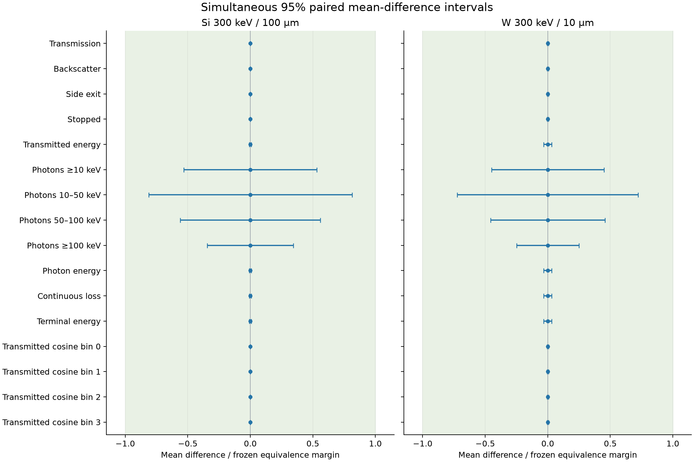

# Mixed-precision transport: paired numerical equivalence

This check compares an experimental radiative helper implementation with the
production FP64 helper on two fixed 300 keV scenes. It tests the means of the
frozen scored observables; it does not establish distributional identity,
physical-model sign-off, continuum convergence or cross-engine agreement.
Production source/defaults and model markers are unchanged.

## Precision boundary and measurement design

`rad-quotient32-24` derives from the endpoint-preserving `rad-boundary64-24` arm.
It retains FP64 node coordinates and coordinate subtraction, then casts operands
before dividing in three locations: SDCS interpolation weights, dimensionless
cell widths and inverse-photon interpolation. Cell transcendental evaluation and
per-atom moment accumulation remain FP32. Reduced photon coordinates and
incident-energy interpolation still contain FP64 operations. All six previous
helper variants remain byte-identical. See the
[precision experiment](../../repo-design/compute/transport-precision-experiment.md)
for the original endpoint failure and precision boundaries.

The frozen `checks/equal_precision/precision-quotient.json` defines:

- Full Si/W table and endpoint component probes; 64-primary preflight across
  all six existing scenes; trajectory energy/support/direction invariants.
- Five fresh-process timing repetitions per arm for Si/100 µm and W/10 µm,
  normal-incidence 300 keV pencil beams, 5000 primaries. Arms: FP64,
  boundary64 and quotient32. Pilot seeds: 61001–61005.
- Held-out FP64/quotient32 comparison with ten fresh replica seeds 62001–62010:
  120000 primaries per Si replica and 25000 per W replica, hence 1.2 million
  and 250000 per arm. Each process uses 5000-primary internal blocks,
  4096 MiB scratch, the same full-population warmup and a separate warmup seed.
- One requested CPU thread, one RTX 5080 and 24 GiB per GPU allocation.
  One five-minute preflight, two ten-minute pilots and nine ten-minute
  held-out allocations give a maximum allocation budget of 115 GPU minutes.
  Actual use is recorded separately. Dependencies fail closed after failed
  component/invariant gates, process deadlines or deferred fixed-design work.

Physics settings, tables, source hashes, seed lists, margins and populations are
frozen before held-out outcomes. PXR/CBS work is excluded. Timing is synchronized
transport/emission including unchanged host photon-angle completion; setup,
compilation, complete-workload warmup, audits and reductions are separate.
The earlier pilot's approximate normal intervals remain historical diagnostics.

## Pairing and uncertainty

The API constructs transport keys from `(seed, global primary index)` and uses
an independently salted radiative domain. The adapter passes the global primary
offset into each internal block and stores scores in that same order. Each
precision arm is a function of the same per-primary streams. A paired difference
is valid even when the resulting trajectories diverge; it does not require
identical photon/event sequences. This coupling is specific to these audited
PyRITE implementations, rather than inferred from equal integer seed labels.

Samples record ordered primary ranges, SHA-256 fingerprints of both key arrays,
and normalized source hashes for API, stream construction, batching, kernels and
score ordering. The analyzer verifies them and rejects mismatches. It also
requires the full fixed seed/population design, original/variant source pins,
raw-score digests, warmups, complete trajectory audits, table/configuration
identity and controls matching resolved preflight inputs. Pilot/preflight scores
are excluded from the held-out family. Missing/failed replicas leave the whole
study unresolved; no selected-subset confidence statement is issued.

There are 16 means per scene, hence 32 simultaneous comparisons: four terminal
fractions; transmitted energy per incident primary; four photon count bands;
photon, continuous-loss and terminal energy per primary; and four transmitted
cosine bins. Under the independent-primary random-stream model, the difference
of paired scores estimates the difference of means directly and retains their
covariance.

Let each arm's score lie in the known interval $[0,B]$, with paired difference
$D$, sample mean $\bar D$ and unbiased sample variance $s_D^2$. The
[Maurer–Pontil empirical Bernstein bound, Theorem 4](https://www.cs.mcgill.ca/~colt2009/papers/012.pdf)
applied to the scaled difference yields a two-sided interval with radius

$$
\sqrt{\frac{2s_D^2\ell}{N}}+
\frac{14B\ell}{3(N-1)},\qquad
\ell=\log(8m/\alpha).
$$

A second interval bounds the probability that a primary differs. For $K$
nonzero differences, let $p_U$ be the one-sided exact Clopper–Pearson upper
bound at error probability $\alpha/(2m)$. Since
$|\mathbb E D|\leq B\Pr(D\ne0)$, this gives $[-Bp_U,Bp_U]$.
The analyzer intersects these two intervals. Splitting the error budget between
methods and tails, then across $m=32$ comparisons, gives joint confidence at
least 95% under the stated model. Dependence among the observables is allowed.

At zero discordance, $p_U=1-(\alpha/(2m))^{1/N}$ remains positive. Identical
observed counts therefore do not imply exact equivalence. No Gaussian/Poisson
approximation or observed-maximum support estimate is used to qualify results.
Known score bounds are 1 for indicators, beam energy plus ledger tolerance for
energies, and the energy-conservation bound $\lfloor E_0/k_{\min}\rfloor$
for photon counts. The last is deliberately conservative for rare multiple
photons.

## Frozen equivalence margins

A comparison passes only when its entire simultaneous interval lies inside its
margin. An interval entirely outside fails; overlap remains unresolved. The
whole observable set passes only if all 32 comparisons pass on complete data.
The margins are the prior study's 0.005 absolute fractions, 1.5 keV per-primary
energies and 5% photon yields. Photon margins are frozen in absolute units using
separate FP64 planning seeds 59001–59005, not held-out estimates:

| Source score | Si margin (photons/primary) | W margin (photons/primary) |
| --- | ---: | ---: |
| ≥10 keV | 0.000336 | 0.001908 |
| 10–50 keV | 0.000220 | 0.001188 |
| 50–100 keV | 0.000064 | 0.000376 |
| ≥100 keV | 0.000052 | 0.000344 |

These are numerical tolerances relative to a frozen planning scale, rather than
confidence bounds on the unknown physical reference yield. The strict Si
10–50 keV margin drives the validation population. Failure to resolve it does
not permit changing the margin or adding optional samples to this fixed study.

## Reproduction

Stage the developer harness and pinned physical inputs with maintained
`pyrite remote sync`. Use `precision-quotient.sbatch` from the staged lab checkout.
Submit preflight with a five-minute limit, then serial `afterok` dependencies for
`si`, `w`, the five `heldout-si` slices (0:2, 2:4, 4:6, 6:8, 8:10), and four
`heldout-w` slices (0:3, 3:6, 6:8, 8:10). Each non-preflight stage takes the
preflight evidence directory as its second argument, then start/stop replica
indices as third/fourth arguments. Keep the default ten-minute chunk limit.
Each job retains the submitted script, source snapshots, generated CUDA,
primary scores, table hashes, allocation/GPU state and checksums under
`scratch/quotient/<job-id>`.

Analyze timing only from the preflight/pilot directories, and equivalence only
from the nine held-out directories. Pass the captured protocol bytes so raw
hashes match, including line endings. These commands use the recorded job IDs
from the staged checkout; adjust the evidence-root prefix after extraction:

```bash
uv run python checks/equal_precision/analyze_precision.py \
  scratch/quotient/{1378,1379,1380} \
  --protocol scratch/quotient/1378/source/precision-quotient.json \
  --output /tmp/quotient-timing.json

uv run python checks/equal_precision/analyze_equivalence.py \
  scratch/quotient/{1381..1389} \
  --protocol scratch/quotient/1378/source/precision-quotient.json \
  --preflight scratch/quotient/1378 --output /tmp/quotient-equivalence.json
```

The inference implementation is `checks/equal_precision/paired_equivalence.py`;
current SciPy's beta inverse-survival function supplies the nonzero binomial
upper quantile. Analytic tests cover narrow cells, exact zero/nonzero mismatch
bounds and injected bias. Fixed-seed Bernoulli coverage checks are regression
smoke checks, not a substitute for the bound's assumptions/proof. Loader tests
reject pairing, support, phase, completeness and frozen-control violations.

## RTX 5080 results (2026-10-15)

The complete fixed design passed all **32 simultaneous mean-equivalence
comparisons**, with no failed or unresolved comparisons. Each arm contributed
1.2 million held-out Si primaries and 250000 W primaries over ten seeds. The
confidence statement is joint 95%, conditional on the independent-primary RNG
model described above. No pilot samples were pooled into this family.

All terminal, angular-bin and photon-count scores matched their paired reference
scores in the observed populations. Their confidence intervals remain nonzero.
The largest absolute mean energy-score difference was 1.59e-7 keV per primary;
individual energy scores differ, so the implementations are not bitwise equal.
The tightest normalized interval was Si 10–50 keV: ±0.000178865 photons per
primary against the frozen ±0.000220 margin (81.3% of the margin). The corresponding
W interval was ±0.000858542 against ±0.001188 (72.3%).



Five independent 5000-primary pilot timings per arm gave these synchronized
transport medians, after full-workload warmup:

| Scene | FP64 (s) | Boundary64 (s) | Quotient32 (s) | FP64 / quotient32 |
| --- | ---: | ---: | ---: | ---: |
| Si, 300 keV, 100 µm | 1.7191 | 1.6018 | 1.4979 | 1.148× |
| W, 300 keV, 10 µm | 6.1921 | 5.7474 | 5.2552 | 1.178× |

These ratios describe this small synchronized timing workload. They correspond
to 12.9% and 15.1% less transport time, respectively; they are not estimates of
whole-application speedup or time to a physical accuracy target. Compilation,
setup, full-population warmup, audits and analysis are outside this timer.

The new arm passed all 4000 component cases. Its maximum scaled soft/hard moment
errors were 2.42e-7 / 2.88e-7, and maximum inverse-photon error divided by incident
energy was 3.20e-6. All components were finite, nonnegative and within photon
support. Complete trajectory audits and pinned source/table/control checks passed.
GPU jobs 1378–1389 all completed with exit code zero and consumed 79.53 allocation
wall minutes in the GPU partition. CPU jobs handled tests, analysis and docs.

Machine-readable evidence:

- [Final simultaneous intervals and provenance](../check-records/equal-precision/quotient-equivalence-summary.json)
- [Pilot timings and component probes](../check-records/equal-precision/quotient-pilot-summary.json)
- [Harness verification](../check-records/equal-precision/quotient-method-verification.json)

The raw scores, CUDA, source snapshots, submitted scripts, job records and logs
remain in the ignored `scratch/quotient-results/quotient-evidence.tar.gz` archive
and the lab checkout. Its SHA-256 is
`3814b9ec2609d0fb1711db4c4087cd153ccc50cc128d2d234e82b2215774e6d2`.
All twelve GPU evidence manifests were checked before analysis; the downloaded
archive hash was checked before extraction. Regenerate the figure with:

```bash
uv run python checks/equal_precision/plot_equivalence.py \
  /tmp/quotient-equivalence.json /tmp/quotient-equivalence.png
```

This completes the bounded quotient-precision experiment. Production remains
unchanged. Other energies, materials, detector scores, cutoff/step convergence,
full distribution comparisons and cross-engine time-to-precision remain outside
this result and require their own acceptance checks under issue #510.

## Stricter numerical-budget audit

The 5% relative photon-yield margins above are equivalence tolerances. Issue
#510 separately requires each numerical change to fit within one-third of the
statistical-error budget at target RSEs of 5%, 2% and 1%. Reusing the same
simultaneous intervals against these nested budgets gives:

| Target RSE | Numerical intervals inside budget | Unresolved | Failed |
| --- | ---: | ---: | ---: |
| 5% | 21 / 32 | 11 | 0 |
| 2% | 20 / 32 | 12 | 0 |
| 1% | 20 / 32 | 12 | 0 |

The audit uses `prior_reference_mean × target_RSE / 3` as the absolute numerical
budget. These are the independently frozen planning means, not current held-out
means or confidence bounds on unknown physical means. It reuses the original
32-interval family, so evaluating three nested budgets adds no comparisons or
new inference. Two side-exit scores have zero planning means and no declared
absolute floor for this stricter gate; they remain unresolved at every target.
An interval crossing a budget is unresolved, not evidence of a discrepancy.

At 5%, seven photon-count comparisons and both photon-energy comparisons are
unresolved in addition to those two side-exit scores. W photons above 100 keV
pass this budget at 5%, but remain unresolved at 2% and 1%. The diagnostic
observed RSEs are recorded separately and never stand in for numerical accuracy;
zero/undefined RSE does not establish precision.

The Si 10–50 keV budget at the 5% target is 0.0000733333 photons per primary.
Its current interval is ±0.000178865. For the exact zero-discordance mismatch
bound alone to fit that budget requires at least 2926885 paired Si primaries;
the corresponding W planning floor is 542013. At the 2% and 1% targets these
Si floors rise to 7317217 and 14634437. These calculations assume zero future
count differences, the same confidence family and unchanged physical support.
They are neither guaranteed sufficient populations nor permission for optional
stopping or pooling a later study into this one. Photon-energy scores already
differ and require their own variance-based planning.

The [machine-readable budget audit](../check-records/equal-precision/quotient-budget-summary.json)
preserves every interval, budget, descriptive RSE and zero-discordance planning
floor. Reproduce from the completed study without running transport:

```bash
uv run python checks/equal_precision/audit_precision_budget.py \
  docs/validation/check-records/equal-precision/quotient-equivalence-summary.json \
  --protocol scratch/quotient/1378/source/precision-quotient.json \
  --output /tmp/quotient-budget-summary.json
```

Use the captured protocol's original bytes from the evidence archive. The tool
rejects incomplete families, mismatched protocol/source pins, duplicate scores,
invalid intervals and changed confidence/support pins. Boundary arithmetic,
nested-budget outcomes, zero scales and corrupt-family rejection have focused
regression checks. No extra GPU samples were collected for this audit. A later
fixed design needs its own population/seed plan and must also address step,
cutoff, table and quadrature convergence before any time-to-precision ranking.

The [small numerical/backend follow-up](cheap-numerical-validation.md) audits
table coverage, active step controls, cutoff sensitivity and comparator thresholds
without extending this precision study.
